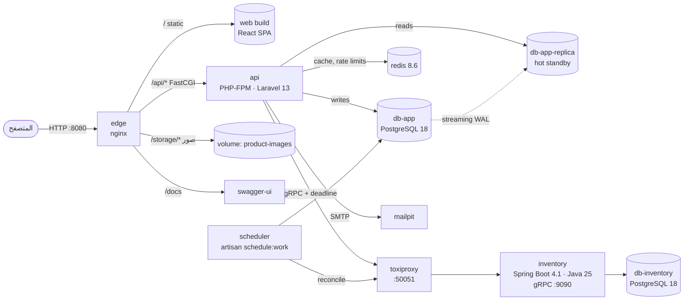
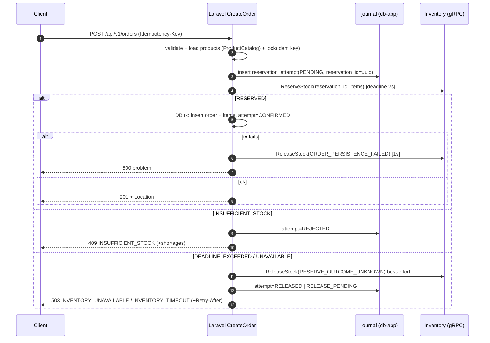

# 01 — المعمارية

## 1. نظرة عامة (C4 — مستوى الحاويات)

- **أصل واحد (Single origin):** الواجهة والـ API خلف `edge` نفسه ⇒ لا حاجة لـ CORS في التشغيل، وكوكي الـ refresh يعمل بـ `SameSite=Strict`.
- **Toxiproxy دائماً في المسار** بين التطبيق والمستودع (في التطوير والعرض) ⇒ نستطيع حقن البطء أو القطع أمام الممتحن دون تعديل كود (PROOF-R2-2، R2-E2).
- لا منفذ منشور على الجهاز إلا `edge` (و Mailpit UI للتطوير). قواعد البيانات و gRPC داخل شبكة Docker فقط.

## 2. خدمات Compose
| الخدمة | الصورة/البناء | ملاحظات |
|---|---|---|
| `edge` | `nginx:1.30.6-alpine` (stable؛ فرع 1.29 انتهى — ADR-0010) + `infra/nginx/` | `server_tokens off`، `client_max_body_size 3m`، ترويسات أمان للـ SPA |
| `api` | `backend/api/Dockerfile` (php:8.4-fpm + `ext-grpc` + `ext-pdo_pgsql` + `ext-sodium` + opcache) | `expose_php=Off`؛ healthcheck عبر `php-fpm-healthcheck` أو `/api/v1/health` |
| `scheduler` | نفس صورة `api` | `php artisan schedule:work` (المصالحة كل دقيقة) |
| `db-app` | `postgres:18-alpine` | volume مستقل؛ الأصل (primary) للكتابات منذ المتطلب 3 |
| `db-app-replica` | `postgres:18.6-alpine3.24` | نسخة قراءة hot standby بالـ streaming replication (ADR-0014)؛ `db-app-roles` (لمرة واحدة) ينشئ دور النسخ |
| `redis` | `redis:8.6.8-alpine3.23` | مخزن الكاش ومحدِّدات المعدّل (ADR-0013)؛ بلا تخزين دائم ولا منفذ منشور |
| `inventory` | `backend/inventory/Dockerfile` (multi-stage، JRE 25، مستخدم غير root) | gRPC health + reflection؛ actuator على منفذ داخلي |
| `db-inventory` | `postgres:18-alpine` | volume مستقل، **لا يصل إليها `api` شبكياً** (شبكة `inventory-net` منفصلة) |
| `toxiproxy` | `ghcr.io/shopify/toxiproxy` | proxy `inventory` : `0.0.0.0:50051 → inventory:9090` |
| `swagger` | `swaggerapi/swagger-ui` | يقرأ `contracts/openapi/openapi.yaml` |
| `mailpit` | `axllent/mailpit` | بريد الإشعارات في التطوير |
| `web-dev` (profile `dev`) | Vite dev server | proxy `/api` → `edge` |
| `k6` (profile `tools`) | `grafana/k6` | `tests/load/` |
| `buf` (profile `tools`) | `bufbuild/buf:1.75.0` | lint/breaking/format + توليد PHP stubs بإضافات BSR مثبتة الإصدار (`buf.gen.yaml`) |
| `toolbox` (profile `tools`) | `infra/toolbox/Dockerfile` | `grpcurl` + `psql` + `jq` + `curl` للعرض والتشخيص؛ متصل بالشبكتين (أداة تشخيص فقط، ليست جزءاً من التطبيق) |

**عزل الشبكات (يثبت R2-S2 مادياً):**
- `app-net`: edge, api, scheduler, db-app, db-app-replica, redis, toxiproxy, mailpit, swagger
- `inventory-net`: toxiproxy, inventory, db-inventory
- `api` ليس على `inventory-net` ⇒ مستحيل أن يتصل بـ `db-inventory` حتى لو أراد.

## 3. التطبيق الأساسي — Modular Monolith (Laravel)
```
backend/api/
├── app/
│   ├── Modules/
│   │   ├── Users/          Http/{Controllers,Requests,Resources} · Models · Actions · Policies · Contracts · Database/{Migrations,Factories,Seeders} · Providers/UsersServiceProvider.php · routes.php
│   │   ├── Products/       … + Contracts/ProductCatalog.php (واجهة عامة تعيد DTOs)
│   │   ├── Orders/         … + Domain/OrderStatus.php (state machine) · Contracts/OrderQueries.php
│   │   └── Notifications/  Messaging (عامل طابور البريد) · Mail · Http …
│   └── Shared/
│       ├── Http/           ProblemDetails, ExceptionRenderer, Middleware/{SecurityHeaders, RequestId, ForceJson}
│       ├── Auth/           JwtGuard, TokenIssuer, RefreshTokenService, Role enum
│       └── Inventory/      InventoryGateway (interface) · GrpcInventoryGateway · DTOs · Exceptions
├── generated/grpc/         ← مولَّد من proto (لا يُعدّل يدوياً، مُلتزَم مع فحص انحراف في CI)
├── routes/api.php          ← يحمّل routes.php لكل وحدة تحت prefix v1
└── tests/{Feature,Unit,Arch}/<Module>/
```
### قواعد الحدود (تُفرض بـ `tests/Arch/ModuleBoundariesTest.php`)
- `App\Modules\X` لا يستخدم `App\Modules\Y\Models\*` ولا `Y\Database\*` ولا `Y\Actions\*` — فقط `App\Modules\Y\Contracts\*` و DTOs.
- لا FK بين جداول وحدتين مختلفتين؛ المرجع عمود ULID عادي (مثال: `order_items.product_id`) مع **نسخة لقطة** (snapshot) من الاسم والسعر وقت الطلب.
- الأحداث بين الوحدات رسائل RabbitMQ (المتطلب 4): أنواعها معرّفة في `Contracts/Messages` للوحدة المُصدِرة (`Orders\Contracts\Messages\OrderMessages`)، تُكتب في الـ outbox داخل معاملة الطلب وتُنشر بعد الـ commit (ADR-0015، `docs/10-async-realtime.md`).
- `Shared` لا يعتمد على أي `Modules\*`.

### نمط الكود داخل الوحدة
- Controller رفيع: يتحقق (FormRequest) ← يفوّض (Policy) ← ينفّذ Action ← يعيد Resource.
- Action = حالة استخدام واحدة، قابلة للاختبار دون HTTP (`CreateOrder`, `ChangeOrderStatus`, `RegisterUser`…).
- المعرّفات ULID (`HasUlids`). المال: عدد صحيح بالوحدة الصغرى (`price_minor`) + `currency` ثابتة `SYP` (قرار الإنسان في P0).
- لا Eloquent خارج وحدته. لا `Model::unguard()`. `$fillable` صريح.

## 4. خدمة المخزون — Hexagonal (Spring Boot)
```
backend/inventory/
├── build.gradle.kts            protobuf plugin يقرأ ../../contracts/proto
├── src/main/java/com/ecommerce/inventory/
│   ├── grpc/                   InventoryGrpcService (adapter) · InventoryExceptionHandler (`GrpcExceptionHandler` bean) · RequestValidator · RequestIdServerInterceptor
│   ├── application/            ReservationService · StockQueryService · StockAdjustmentService  (@Transactional هنا فقط)
│   ├── domain/                 Reservation, ReservationStatus, StockLevel, Shortage, exceptions  (Java records/sealed, بلا Spring)
│   └── persistence/            StockRepository · ReservationRepository  (JdbcClient + SQL صريح)
├── src/main/resources/db/migration/   Flyway V1__…sql
└── src/test/java/…             unit + Testcontainers integration + concurrency
```
- SQL صريح (JdbcClient) لا JPA: نحتاج تحكماً دقيقاً بـ `SELECT … FOR UPDATE` وترتيب الأقفال (انظر `05`).
- `spring.threads.virtual.enabled=true` لعمال التطبيق؛ مجمع اتصالات Hikari بحجم صريح.
- gRPC: health service + reflection مفعّلان (للعرض بـ `grpcurl`)، graceful shutdown.

## 5. الواجهة (React)
```
frontend/src/
├── api/        schema.d.ts (مولَّد) · client.ts (openapi-fetch + auth middleware + single-flight refresh) · problem.ts
├── auth/       AuthProvider (access token في الذاكرة فقط) · guards
├── features/   products/ · cart/ · orders/ · admin/ · notifications/
├── routes/     TanStack Router (file-based) — معاملات البحث (category, page) typed + validated بـ Zod
├── mocks/      MSW handlers مولّدة/مكتوبة وفق OpenAPI (للتطوير المتوازي قبل جاهزية الـ API)
└── i18n/       نصوص عربية، `dir="rtl"`
```

## 6. تدفق إنشاء الطلب (R2-F1) — مختصر

التفاصيل الكاملة وكل حالة فشل: `docs/05-inventory-consistency.md`.

## 7. الملاحظة عبر الخدمتين (أساس للمتطلب 6)
- `X-Request-Id`: يُولَّد في `edge` إن غاب، يُسجَّل في كل سطر log، يُعاد في الاستجابة وفي `trace_id` داخل problem+json، ويُمرَّر كـ gRPC metadata `x-request-id`.
- Logs بصيغة JSON على stdout في الخدمتين.

## 8. الاستعداد للمتطلبات القادمة (قرارات الآن كي لا نهدم لاحقاً)
| المتطلب | ما نفعله الآن |
|---|---|
| 3 التخزين المؤقت | **منفَّذ:** كاش الكتالوج في Redis بلا المخزون (ADR-0013)، ETag/304، فهرس `orders(created_at, id)`، نسخة قراءة مع read-your-writes (ADR-0014) — التقرير: `docs/performance-report.md` |
| 4 غير متزامن/لحظي | **منفَّذ:** أحداث الطلبات عبر outbox ← RabbitMQ ← عاملان مستقلان (بريد، بث) مع retry و DLQ (ADR-0015)؛ WebSocket عبر Reverb بقناتين خاصتين موقّعتين (ADR-0016) — `docs/10-async-realtime.md` |
| 5 التوسع | API عديم الحالة (JWT + refresh في DB)، الصور على volume قابل للاستبدال بـ S3، لا sessions |
| 6 المراقبة | Request-Id، JSON logs، health endpoints، actuator/Micrometer جاهز في Spring |
