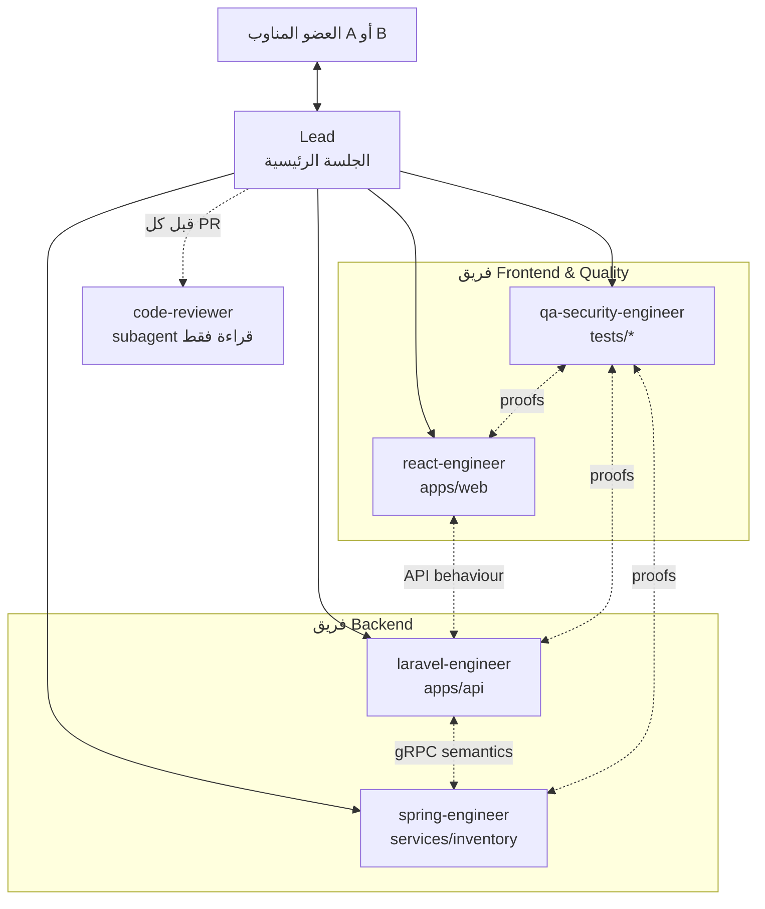

# 07 — الفريق (بشر + وكلاء) وسير العمل في Git

## 1. الطبقتان
- **الفريق البشري (عضوان: A و B):** يملكان القرار، يراجعان، يفتحان طلبات الدمج من حساباتهما، ويُسألان في المقابلة.
- **فريق الوكلاء (Claude Code Agent Teams):** ينفّذ. الجلسة التي يفتحها العضو المناوب هي **Lead**.



## 2. الأدوار
| الوكيل | يملك | لا يلمس | يتواصل مع |
|---|---|---|---|
| Lead | `contracts/` `docs/` `tasks/` `infra/` `compose*.yaml` `Makefile` `.github/` `CLAUDE.md` | كود المكوّنات | الكل + الإنسان |
| laravel-engineer | `apps/api/**` (عدا `generated/`) | العقود | spring (دلالات gRPC)، react (سلوك API) |
| spring-engineer | `services/inventory/**` | العقود | laravel |
| react-engineer | `apps/web/**` (عدا `src/api/schema.d.ts`) | العقود | laravel |
| qa-security-engineer | `tests/e2e/` `tests/load/` `tests/security/` | كود الإنتاج (يبلّغ عن العيوب فقط) | الكل |
| code-reviewer (subagent) | — قراءة فقط | كل شيء | Lead |

## 3. بروتوكول التواصل بين الوكلاء
رسائل `SendMessage` قصيرة ومهيكلة:
```
[CONTRACT-REQUEST] from: laravel-engineer
need: field `reservation_id` on Order resource (admin only)
why: admin UI must show it for reconciliation debugging
proposal: components.schemas.OrderAdmin.reservation_id: string(uuid)
blocking: P2-API-06
```
| النوع | المعنى |
|---|---|
| `[CONTRACT-REQUEST]` | طلب تغيير عقد ⇒ للـ Lead فقط |
| `[QUESTION]` | غموض ⇒ للـ Lead (يسأل الإنسان إن لزم) |
| `[HANDOFF]` | "انتهيت من X، جاهز للاستهلاك" + الفرع + الأوامر للتحقق |
| `[DEFECT]` | من QA: خطوات إعادة الإنتاج + المتوقع/الفعلي + الاختبار الفاشل |
| `[BLOCKED]` | متوقف على شيء + ما جرّبته |
لا يُقبل "تم" دون أوامر تحقق قابلة للتشغيل.

## 4. Worktrees (منع تعارض الملفات وفصل الفروع)
وكلاء الفريق يتشاركون نظام الملفات؛ تعديل نفس الملف من وكيلين = كتابة فوق بعض. لذلك:
- **كل وكيل منفّذ في worktree خاص على فرع مهمته:**
  ```bash
  make wt NAME=api   BRANCH=feat/r1-auth-jwt         # ⇒ ../<repo>-wt/api
  make wt NAME=inv   BRANCH=feat/r2-inventory-core   # ⇒ ../<repo>-wt/inv
  make wt NAME=web   BRANCH=feat/r1-web-auth
  make wt NAME=qa    BRANCH=test/r1-security-proofs
  ```
- `make wt` (يكتبه الـ Lead في P0): `git worktree add`، ينسخ `.env.example` إلى `.env` مع `COMPOSE_PROJECT_NAME=<repo>-<NAME>` و `EDGE_PORT` فريد (8081..8084)، ويضبط مؤلف الـ commits للعضو المسؤول:
  `git -C <wt> config extensions.worktreeConfig true && git -C <wt> config --worktree user.name "<Member>" && … user.email`
- الـ Lead يعطي كل وكيل **المسار المطلق** لـ worktree في رسالة الإطلاق، والوكيل يبدأ كل أمر Bash بـ `cd <path> &&`.
- التكامل الكامل (`make up`، E2E، demo) يُشغَّل من النسخة الرئيسية على `main` بعد الدمج.
- بعد دمج أي PR: كل وكيل نشط ينفذ `git fetch && git rebase origin/main` في worktree الخاص به.

## 5. الفروع والـ Commits
- `main` محمي. فروع: `feat/r{1|2}-<scope>`, `fix/…`, `test/…`, `chore/…`, `docs/…`.
- Conventional Commits بالإنجليزية: `feat(orders): enforce owner-only access with 404 on foreign orders`.
- commit صغير لكل خطوة منطقية؛ لا commit يكسر البناء.
- Squash merge، تاريخ خطي.

## 6. طلبات الدمج (PR) — W-1, W-2
1. الوكيل يكمل المهمة ⇒ `make verify-<component>` أخضر.
2. الـ Lead يستدعي `code-reviewer` على `git diff origin/main...HEAD` ⇒ يصلح الوكيل الملاحظات.
3. skill `ship-pr` يحضّر الوصف (القالب `.github/pull_request_template.md`).
4. **العضو المالك** يدفع الفرع ويفتح الـ PR من حسابه (`gh pr create`) — الـ Lead لا يدفع ولا يدمج دون إذن صريح (إعدادات الصلاحيات تفرض السؤال).
5. **العضو الآخر** يراجع على GitHub (يقرأ الكود فعلاً — سيُسأل عنه، W-3)، ويوافق ⇒ دمج.

### توزيع الـ PRs على العضوين (يضمن W-2 مع توازن الفهم)
| PR | المتطلب | المالك | المراجع |
|---|---|---|---|
| `chore/p0-contracts` (OpenAPI + proto + errors) | 1 | A | B |
| `chore/p0-platform` (compose, nginx, Makefile, CI) | 1 | B | A |
| `chore/p0-api-skeleton` · `test/p0-harness` | 1 | A | B |
| `chore/p0-inventory-skeleton` · `chore/p0-web-skeleton` | 1 | B | A |
| `feat/r1-auth-jwt` (Users + JWT + rate limit + headers + problem+json) | 1 | A | B |
| `feat/r1-products` (Products + images + pagination) | 1 | B | A |
| `feat/r1-orders-security` (Orders + Policies + PROOF-R1) | 1 | A | B |
| `feat/r1-notifications` | 1 | B | A |
| `feat/r1-web` (auth, catalog, cart, orders, admin) | 1 | B | A |
| `test/r1-security-proofs` (E2E + http + demo-r1) | 1 | A | B |
| `feat/r2-inventory-service` (Spring كامل + اختبارات التزامن) | 2 | B | A |
| `feat/r2-inventory-gateway` (gRPC client + deadlines + mapping + stock في المنتجات) | 2 | A | B |
| `feat/r2-order-saga` (الحجز + التعويض + journal + reconciler + إلغاء) | 2 | A | B |
| `feat/r2-web-stock-ux` | 2 | B | A |
| `test/r2-race-chaos` (k6 + toxiproxy + demo-r2) | 2 | B | A |
⇒ كل عضو له ≥ 4 PRs في المتطلب 1 و ≥ 2 في المتطلب 2، وكل عضو راجع جانب زميله.

## 7. حماية الفرع الرئيسي
> ملاحظة: حماية الفروع للمستودعات **الخاصة** تتطلب GitHub Pro/Team (مجاني للطلاب عبر GitHub Education) أو اجعل المستودع عاماً.
```bash
gh api -X PUT "repos/{owner}/{repo}/branches/main/protection" --input - <<'JSON'
{
  "required_status_checks": { "strict": true, "contexts": ["contracts", "api", "inventory", "web", "e2e"] },
  "enforce_admins": true,
  "required_pull_request_reviews": { "required_approving_review_count": 1, "dismiss_stale_reviews": true },
  "restrictions": null,
  "required_linear_history": true,
  "allow_force_pushes": false,
  "allow_deletions": false,
  "required_conversation_resolution": true
}
JSON
```
أسماء `contexts` يجب أن تطابق أسماء jobs في `.github/workflows/ci.yml`.

## 8. إيقاع كل مرحلة
1. الـ Lead في **Plan mode** يقرأ ملف المرحلة ويعرض خطة التوزيع ⇒ الإنسان يوافق.
2. Lead ينشئ worktrees ويطلق الوكلاء بأسماء ثابتة وأنواع subagent (انظر `KICKOFF.md`).
3. الوكلاء ينفذون وفق قائمة المهام المشتركة (5–6 مهام لكل وكيل كحد أقصى في الدفعة).
4. hooks: `TaskCompleted` يشغّل تحقق المكوّن ويمنع الإغلاق إن فشل؛ `TeammateIdle` يمنع الخمول مع تغييرات غير مُلتزمة.
5. مراجعة ⇒ PR ⇒ دمج ⇒ rebase ⇒ الدفعة التالية.
6. نهاية المرحلة: `make verify` + `make demo-rN` من `main` + تحديث `docs/08-interview-prep.md`.
