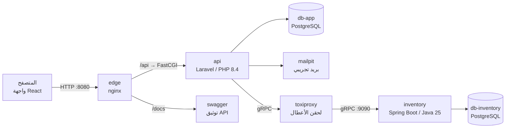
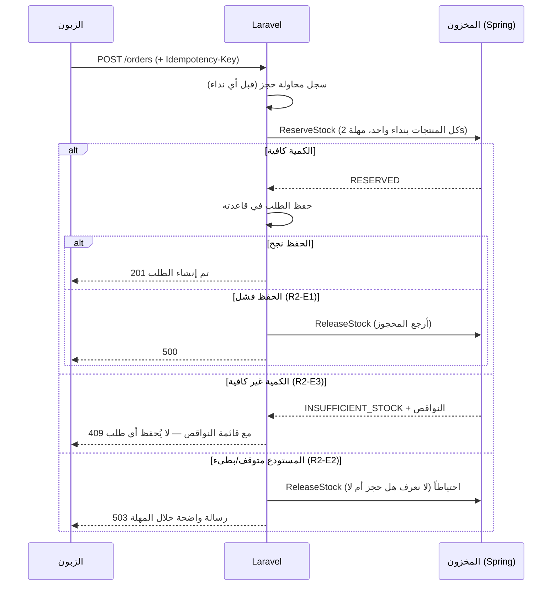

# 09 — شرح المشروع كاملاً للفريق (المتطلب 1 + المتطلب 2)

> هذا الملف لكل أعضاء الفريق. اقرأه من الأول للآخر مرة واحدة، ثم ارجع لأي قسم عند الحاجة.
> المحاضر قد يسأل **أي عضو عن أي جزء** — لذلك كل واحد منا يجب أن يفهم الصورة كاملة، لا جزءه فقط.

---

## 1. الفكرة في جملتين
متجر إلكتروني صغير، لكنه مبني **كالأنظمة الحقيقية**: التطبيق الأساسي (PHP/Laravel) يدير المستخدمين والمنتجات والطلبات، وخدمة **منفصلة** للمخزون (Java/Spring Boot) لها قاعدة بياناتها الخاصة، ويتكلمان مع بعض عبر **gRPC**.
التقييم ليس على جمال الواجهة، بل على: **الأمان، صحة البيانات تحت الضغط، والتصرف الصحيح عند الأعطال**.

---

## 2. الصورة الكبيرة (من يكلّم من)



| الخدمة | ما هي | لماذا موجودة |
|---|---|---|
| `edge` | nginx | البوابة الوحيدة المفتوحة للخارج (منفذ 8080): يقدّم الواجهة، يمرّر `/api` للتطبيق، يضيف ترويسات الأمان |
| `api` | Laravel 13 | التطبيق الأساسي: المستخدمون، المنتجات، الطلبات، الإشعارات |
| `scheduler` | نفس صورة api | للمهام الدورية (جاهز للمتطلبات القادمة) |
| `db-app` | PostgreSQL 18 | قاعدة التطبيق الأساسي |
| `inventory` | Spring Boot 4.1 | خدمة المخزون: الكميات، الحجز، الإرجاع، التعديل |
| `db-inventory` | PostgreSQL 18 | قاعدة المخزون — **التطبيق لا يستطيع الوصول إليها أبداً** |
| `toxiproxy` | وسيط | يقع بين api و inventory؛ نستخدمه لنحاكي "المستودع متوقف/بطيء" |
| `swagger` | Swagger UI | توثيق الـ API قابل للتجربة على `/docs` |
| `mailpit` | صندوق بريد وهمي | نرى فيه رسائل الإشعارات على `localhost:8025` |

**العزل (مهم للمقابلة):** يوجد شبكتان في Docker: `app-net` و `inventory-net`. حاوية `api` **ليست** على `inventory-net` أصلاً، فلا تستطيع حتى معرفة عنوان `db-inventory`. هذا يثبت البند R2-S2 فيزيائياً، لا بالاتفاق فقط.

---

## 3. خريطة المجلدات

```
contracts/            ← العقود (أهم مجلد): openapi/openapi.yaml (REST) و proto/ (gRPC) و errors.md
backend/api/          ← Laravel
backend/inventory/    ← Spring Boot
frontend/             ← React
tests/                ← سكربتات الإثبات للمقابلة (demo-r1, demo-r2, race) و k6 و Playwright
infra/                ← إعدادات nginx و toxiproxy وسكربتات المساعدة
docs/                 ← الوثائق والقرارات (ADR)
compose.yaml          ← تعريف كل الحاويات
Makefile              ← كل الأوامر (make up, make demo-r1, ...)
```

**مبدأ "العقد أولاً" (Contract-first):** كتبنا ملف `contracts/openapi/openapi.yaml` (كل endpoint، كل حقل، كل خطأ) و `contracts/proto/inventory/v1/inventory.proto` **قبل** كتابة الكود. الكود يُختبر آلياً أنه يطابق العقد. الواجهة تولّد أنواع TypeScript من العقد، و Laravel يولّد كود gRPC من ملف الـ proto.

---

## 4. التشغيل

| الأمر | ماذا يفعل |
|---|---|
| `make bootstrap` | أول مرة فقط: ينشئ `.env` وكلمات مرور عشوائية، المفاتيح، الجداول، حسابات التجربة |
| `make up` | يشغّل كل الحاويات وينتظر حتى تصبح كلها سليمة |
| `make ps` | يعرض حالة الحاويات |
| `make down` | يوقف كل شيء (البيانات تبقى) |

بعد التشغيل:
- الواجهة: **http://localhost:8080** — وصفحة **دليل العرض**: http://localhost:8080/guide
- توثيق API: http://localhost:8080/docs
- البريد التجريبي: http://localhost:8025

**الحسابات الجاهزة:** المسؤول `admin@example.test` (كلمة المرور في `.env` → `DEV_ADMIN_PASSWORD`)، والزبائن `customer1@example.test` … `customer60@example.test` (كلمة المرور `SEED_CUSTOMER_PASSWORD`). الملف `.env` لا يُرفع إلى GitHub أبداً.

---

## 5. المتطلب 1 — الواجهات البرمجية والأمان

### 5.1 الوحدات الأربع (`backend/api/app/Modules/`)
| الوحدة | ماذا تملك |
|---|---|
| `Users` | التسجيل، الدخول، الأدوار (زبون/مسؤول)، توكنات التحديث |
| `Products` | المنتجات، التصنيفات، الصور، تمرير تعديل المخزون للمستودع |
| `Orders` | إنشاء الطلب، عرضه، آلة الحالات، سجل التغييرات |
| `Notifications` | إشعار + بريد للزبون عند إنشاء الطلب أو تغيير حالته |

بالإضافة إلى `app/Shared/` (الأشياء المشتركة: الأخطاء، الترويسات، JWT، بوابة المخزون).

**قاعدة الحدود:** وحدة لا تستورد Models وحدة أخرى ولا تقرأ جداولها. مثلاً `Orders` تعرف المنتج عبر الواجهة `Products/Contracts/ProductCatalog.php` فقط، والإشعارات تسمع **أحداثاً** (`Orders/Contracts/Events/OrderStatusChanged.php`). هذا **مفروض باختبار آلي** (`backend/api/tests/Arch/`): لو كسر أحدنا القاعدة يفشل الاختبار.

### 5.2 شكل الـ API
- كل المسارات تحت `/api/v1/...` (الإصدار في المسار).
- رموز حالة صحيحة: `201` إنشاء، `200` نجاح، `401` غير مسجل دخول، `403` ممنوع، `404` غير موجود، `409` تعارض، `422` مدخلات خاطئة، `429` محاولات كثيرة، `503` المستودع غير متاح.
- **كل الأخطاء بشكل واحد** (معيار RFC 9457 `application/problem+json`):
  ```json
  {"type":"…","title":"Not found","status":404,"detail":"المورد المطلوب غير موجود.","code":"NOT_FOUND","trace_id":"…"}
  ```
  `code` ثابت تفهمه الواجهة، و `trace_id` يربط الخطأ بسطر في السجلات. الكود: `app/Shared/Http/Problems/`.

### 5.3 المصادقة بـ JWT
- عند الدخول يعطي الخادم **access token** (JWT صالح 15 دقيقة، موقّع بخوارزمية EdDSA) و **refresh token** في كوكي `HttpOnly`.
- الواجهة تحفظ الـ access في **الذاكرة فقط** (لا localStorage — حماية من سرقة XSS).
- عند انتهاء الـ access يُطلب واحد جديد بالـ refresh، والـ refresh **يتبدل** في كل مرة؛ إن استُخدم refresh قديم ⇒ نعتبره سرقة ونلغي كل العائلة.
- التوكن المزوّر، المنتهي، أو بخوارزمية `none` ⇒ `401`.
- الكود: `app/Shared/Auth/` (`JwtGuard`, `TokenIssuer`, `TokenVerifier`) و `app/Modules/Users/Auth/RefreshTokenService.php`.

### 5.4 تحديد المحاولات (Rate limiting)
- الدخول: 5 محاولات/دقيقة لكل (بريد+IP) و 20/دقيقة لكل IP ⇒ المحاولة السادسة `429` مع `Retry-After`.
- التسجيل: 5 حسابات/ساعة لكل IP. إنشاء الطلبات: حد لكل مستخدم.
- الكود: `app/Modules/Users/Providers/UsersServiceProvider.php` و `Orders/Providers/OrdersServiceProvider.php`.

### 5.5 ترويسات الأمان
`Content-Security-Policy` (ضد XSS)، `X-Frame-Options: DENY` (ضد clickjacking)، `X-Content-Type-Options: nosniff`، `Referrer-Policy`، `Permissions-Policy`. على الواجهة من nginx (`infra/nginx/`) وعلى الـ API من `app/Shared/Http/Middleware/SecurityHeaders.php`.

### 5.6 الصلاحيات (أهم نقطة في المتطلب 1)
الملف: `app/Modules/Orders/Policies/OrderPolicy.php`

```php
public function view(AuthUser $user, Order $order): Response
{
    return $user->isAdmin() || $order->user_id === $user->userId()
        ? Response::allow()
        : Response::denyAsNotFound();   // ← 404 وليس 403
}

public function changeStatus(AuthUser $user): Response
{
    return $user->isAdmin() ? Response::allow() : Response::deny();   // ← 403
}
```

- **زبون يفتح طلب زبون آخر ⇒ 404** (لا 403): لأن 403 تعني "الطلب موجود لكنه ليس لك" — وهذا يكشف معلومة. 404 لا يكشف شيئاً (توصية OWASP لثغرة BOLA/IDOR).
- قائمة "طلباتي" مقيّدة في SQL نفسه بـ `where('user_id', …)` — لا نجلب طلبات الآخرين ثم نخفيها.
- **زبون يغيّر الحالة ⇒ 403** (حتى على طلبه هو): تغيير الحالة للمسؤول فقط، والفحص يحدث قبل قراءة البيانات.
- الاختبار الشامل: `tests/Feature/Security/AuthorizationMatrixTest.php` — يجرب **كل endpoint** مع (زائر، مالك، زبون آخر، مسؤول)، ويفشل لو أضاف أحدنا endpoint دون أن يضعه في المصفوفة.

### 5.7 آلة حالات الطلب
`pending → confirmed → shipped → delivered`، ومن `pending` أو `confirmed` ⇒ `cancelled`. أي انتقال آخر ⇒ `409`. كل تغيير يُسجَّل في سجل الحالات مع دور من غيّرها. الكود: `Orders/Domain/OrderStatus.php` و `Orders/Actions/ChangeOrderStatus.php`.

---

## 6. المتطلب 2 — التواصل بين الخدمات (gRPC)

### 6.1 العقد: `contracts/proto/inventory/v1/inventory.proto`
| العملية | معناها |
|---|---|
| `GetStock` | كم بقي من هذه المنتجات؟ |
| `ReserveStock` | احجز كميات **كل** منتجات الطلب — كلها أو لا شيء |
| `ReleaseStock` | أرجِع ما حُجز (عند فشل الطلب) |
| `AdjustStock` | المسؤول يزيد/ينقص الكمية |

من هذا الملف نفسه: Spring يولّد كود الخادم، و Laravel يولّد كود العميل (`backend/api/generated/grpc`).

### 6.2 قاعدة بيانات المخزون (`backend/inventory/src/main/resources/db/migration/V1__init.sql`)
```sql
CREATE TABLE stock_items (
  product_id ...,
  available  bigint NOT NULL CHECK (available >= 0),   -- ← لا يمكن أن تصبح سالبة أبداً
  ...
);
CREATE TABLE reservations (... status IN ('RESERVED','RELEASED'));
CREATE TABLE reservation_lines (...);
CREATE TABLE stock_adjustments (...);
```
**Laravel لا يحتوي أي جدول كميات.** كل ما يخص المخزون في Spring فقط (قرار الفريق D-01).

### 6.3 تدفق إنشاء الطلب (Saga) — `backend/api/app/Modules/Orders/Actions/PlaceOrder.php`



النقاط المهمة:
1. **لا يُحفظ الطلب إلا بعد موافقة المستودع** (نص المتطلب).
2. **نداء واحد** يحجز كل المنتجات معاً — إن نقص منتج واحد لا يُحجز شيء.
3. **Idempotency-Key:** لو ضغط الزبون "تأكيد" مرتين (أو انقطع الاتصال وأعاد الإرسال) لا يُنشأ طلبان.

### 6.4 لماذا ينجح طلب واحد فقط على آخر قطعة؟ (PROOF-R2-1)
الملف: `backend/inventory/.../persistence/StockRepository.java`

```sql
SELECT ... FROM stock_items WHERE product_id IN (...)
 ORDER BY product_id
 FOR UPDATE;                                   -- ① يقفل الصفوف
UPDATE stock_items SET available = available - :quantity ...   -- ② يخصم
```
- **بدون قفل** (الطريقة الخاطئة "اقرأ ثم اكتب"): 10 طلبات تقرأ معاً `available = 1`، كلها ترى أن الكمية كافية، كلها تخصم ⇒ بِعنا 10 قطع ولدينا قطعة واحدة!
- **مع `FOR UPDATE`:** أول معاملة تقفل الصف، والتسع الأخرى **تنتظر**. الأولى تخصم وتنهي ⇒ `available = 0`. الثانية تستلم القفل وتقرأ القيمة **الجديدة** (0) ⇒ ترفض بـ "الكمية غير كافية". وهكذا.
- **`ORDER BY product_id`:** طلبان يحجزان نفس المنتجين بترتيب مختلف قد يقفل كل منهما صفاً وينتظر الآخر للأبد (Deadlock). عندما يقفل الجميع **بنفس الترتيب** يستحيل هذا.
- **`CHECK (available >= 0)`:** شبكة أمان أخيرة في قاعدة البيانات نفسها.
- الاختبار: `backend/inventory/src/test/java/.../ReservationConcurrencyIT.java` — 50 خيطاً معاً على قطعة واحدة ⇒ نجاح واحد بالضبط، على PostgreSQL حقيقي (Testcontainers).

### 6.5 المهل (Deadlines) — R2-E2
| النداء | المهلة |
|---|---|
| GetStock (عرض الكمية) | 500ms |
| ReserveStock | 2000ms |
| ReleaseStock | 1000ms |
| الميزانية الكلية لإنشاء طلب | 3000ms |

- كل نداء gRPC له مهلة صريحة ⇒ **المستخدم لا ينتظر أكثر من ~3 ثوانٍ أبداً**.
- Spring يتحقق من المهلة قبل أن يبدأ العمل؛ إن انتهت لا يغيّر شيئاً.
- الكود: `backend/api/app/Shared/Inventory/Grpc/GrpcInventoryGateway.php` و `InventoryConfig.php`.

### 6.6 ماذا يرى المستخدم عند الأعطال (PROOF-R2-2)
| الحالة | ما يحدث |
|---|---|
| المستودع **متوقف** | إنشاء الطلب ⇒ `503 INVENTORY_UNAVAILABLE` "خدمة المخزون غير متاحة حالياً" خلال ~60ms. صفحات المنتجات **تبقى تعمل** والكمية "غير متاحة حالياً" (تدهور لطيف — graceful degradation) |
| المستودع **بطيء** (3 ثوانٍ) | المهلة تقطع ⇒ `503 INVENTORY_TIMEOUT` خلال ~3 ثوانٍ بدل التعليق |
| بعد عودة المستودع | كل شيء يعود، ولا تضيع أي كمية محجوزة |

---

## 7. الواجهة (React) — `frontend/src/`
| الصفحة | المسار | الملفات |
|---|---|---|
| المنتجات + صفحة المنتج | `/products` | `features/catalog/` |
| السلة | `/cart` | `features/cart/` |
| طلباتي / تفاصيل الطلب | `/orders` | `features/orders/` |
| لوحة المسؤول | `/admin` | `features/admin/` |
| دليل العرض | `/guide` | `features/guide/` |
| الدخول/التسجيل | `/login`, `/register` | `features/auth/` |

الواجهة تتكلم مع الـ API عبر `src/api/client.ts` (أنواعه مولّدة من العقد: لو تغيّر العقد يفشل البناء حيث يُستخدم الحقل). رسائل الأخطاء بالعربية في `src/api/problem.ts`.

---

## 8. الاختبارات (كيف نعرف أن كل شيء صحيح)
| المكوّن | الأمر | العدد |
|---|---|---|
| Laravel | `make verify-api` | 267 اختباراً + تحليل ثابت (Larastan level max) + تنسيق |
| Spring | `make verify-inventory` | اختبارات وحدة + تكامل على PostgreSQL حقيقي، بما فيها السباق و Deadlock |
| React | `make verify-web` | 48 اختباراً + فحص الأنواع + البناء |
| النظام كاملاً | `make demo-r1` / `make race-test` / `make demo-r2` | 45 + 3 + 16 فحصاً على النظام الحي |

**TDD:** للمنطق الحرج (الصلاحيات، الحجز، الإرجاع) كتبنا الاختبار أولاً ورأيناه يفشل، ثم كتبنا الكود.

---

## 9. سيناريو العرض في المقابلة (من الواجهة فقط)
افتح **http://localhost:8080/guide** واتبع الخطوات. باختصار:

| # | الإثبات | من الواجهة |
|---|---|---|
| 1 | PROOF-R1-1: زبون يفتح طلب غيره | customer1 ينسخ رقم طلبه ← customer2 يفتح `/orders/<الرقم>` ⇒ "الطلب غير موجود" |
| 2 | PROOF-R1-2: زبون يغيّر الحالة | زر "محاولة تغيير الحالة (للتجربة)" ⇒ "ليس لديك صلاحية" |
| 3 | المسؤول يغيّر الحالة | لوحة المسؤول ← الطلبات ← "نقل إلى: مؤكد" + بريد في Mailpit |
| 4 | Rate limit | كلمة مرور خاطئة 6 مرات ⇒ "حاولت كثيراً، انتظر…" |
| 5 | PROOF-R2-1: السباق | المسؤول: "اجعل المخزون 1" ← الزبون: "شغّل اختبار التزامن" ⇒ نجاح **1** ورفض 9 |
| 6 | الكمية غير كافية | اطلب أكثر من المتوفر ⇒ قائمة النواقص |
| 7 | PROOF-R2-2: المستودع متوقف | Docker Desktop ← `inventory` ← Stop ⇒ "الكمية غير متاحة حالياً" + رسالة 503 ← Start ⇒ يعود كل شيء |

بديل بالطرفية (نفس الإثباتات آلياً): `make demo-r1`، `make race-test`، `make demo-r2`.

---

## 10. ما أُجّل (قله بصراحة إن سُئلت)
- **إلغاء الطلب لا يُرجع المخزون بعد** (P2-API-04).
- **المصالحة الدورية:** لو فشل نداء الإرجاع نفسه، يبقى السجل `RELEASE_PENDING`؛ المهمة الدورية التي تعيد المحاولة (P2-API-05) مصممة في `docs/05` ولم تُبنَ بعد.
- لا يمسّان أياً من الإثباتات المطلوبة في المتطلبين.

---

## 11. أسئلة متوقعة
الأسئلة والأجوبة المختصرة في **`docs/08-interview-prep.md`** (25 سؤالاً). أهمها:
1. لماذا 404 لا 403 عند فتح طلب الغير؟ (§5.6)
2. لماذا ينجح طلب واحد فقط؟ (§6.4 — اشرح لماذا "اقرأ ثم اكتب" يفشل)
3. ماذا لو فشل الحفظ بعد الحجز؟ (§6.3)
4. لماذا لكل نداء مهلة؟ ماذا يرى المستخدم إن توقف المستودع؟ (§6.5–6.6)
5. كيف تضمن أن التطبيق لا يقرأ قاعدة المستودع؟ (§2 — الشبكات المنفصلة)
6. لماذا JWT قصير + refresh يتبدل؟ (§5.3)

**نصيحة:** كل عضو يشغّل السيناريو كاملاً بيده مرة على الأقل قبل المقابلة، ويفتح الملفات المذكورة هنا ويقرأ الدالة المهمة في كل منها.

---

## 12. التواصل بين Laravel و Spring Boot بالتفصيل (أهم قسم للمقابلة)

### 12.1 مسار النداء الواحد من البداية للنهاية
```
المتصفح → edge (nginx) → api (Laravel)
   → GrpcInventoryGateway::reserve()          [backend/api/app/Shared/Inventory/Grpc/GrpcInventoryGateway.php]
   → InventoryServiceClient (كود مولَّد)       [backend/api/generated/grpc/...]
   → HTTP/2 + Protobuf (ثنائي، ليس JSON)
   → toxiproxy:50051  (وسيط حقن الأعطال)
   → inventory:9090   (Spring Boot gRPC server)
   → RequestIdServerInterceptor → InventoryGrpcService → RequestValidator → CallBudget
   → ReservationService (transaction) → StockRepository (SELECT … FOR UPDATE)
   → db-inventory (PostgreSQL)
```

### 12.2 لماذا gRPC وليس REST بين الخدمتين؟
| | gRPC | REST/JSON |
|---|---|---|
| العقد | ملف `.proto` صارم يولّد كود الطرفين ⇒ خطأ في اسم حقل = خطأ في البناء | توثيق قد يختلف عن الكود |
| الصيغة | Protobuf ثنائي، أصغر وأسرع | نص JSON |
| النقل | HTTP/2: اتصال واحد لطلبات كثيرة | HTTP/1.1 غالباً |
| المهل | **Deadline** مدمج في البروتوكول ويُنقل للخادم | يُبنى يدوياً |
| رموز الأخطاء | `UNAVAILABLE`, `DEADLINE_EXCEEDED`, `INVALID_ARGUMENT`… واضحة | رموز HTTP عامة |

### 12.3 كيف يُولَّد الكود من العقد؟
- **Spring:** إضافة Gradle `com.google.protobuf` تقرأ `contracts/proto` وقت البناء وتولّد `InventoryServiceGrpc` + الرسائل (لا تُحفظ في git).
- **Laravel:** `make gen` يشغّل `buf generate` بإضافتي `protocolbuffers/php` و `grpc/php` ⇒ `backend/api/generated/grpc/` (محفوظ في git، والـ CI يتحقق أنه مطابق للعقد).
- **`buf breaking`** في الـ CI يمنع أي تغيير يكسر التوافق (مثلاً تغيير رقم حقل).

### 12.4 كل نداء له مهلة (Deadline) — ولماذا هذه القيم
- في Laravel: `['timeout' => $deadlineMs * 1000]` على كل نداء؛ القيم من متغيرات البيئة `INVENTORY_DEADLINE_*`.
- **GetStock 500ms:** قراءة لعرض الصفحة — إن تأخرت نعرض الصفحة بلا كمية ("غير متاحة حالياً") بدل أن تتعطل.
- **ReserveStock 2000ms + ميزانية كلية 3000ms:** إنشاء الطلب لا يتجاوز ~3 ثوانٍ مهما حدث.
- **إعادة المحاولة مرة واحدة فقط** عند `UNAVAILABLE` وبشرط بقاء ≥ 1000ms من الميزانية. **آمنة** لأن `ReserveStock` idempotent بنفس `reservation_id`: لو وصل الطلب الأول فعلاً وحجز، الثاني يعيد نفس النتيجة ولا يحجز مرتين.
- **في Spring:** `CallBudget` يفحص المهلة المتبقية **قبل** فتح الـ transaction؛ إن انتهت لا يغيّر شيئاً. و PostgreSQL له `lock_timeout=1500ms` و `statement_timeout=1800ms` — أقل من مهلة العميل، فالخادم لا يبقى يعمل بعد أن استسلم العميل.

### 12.5 تحويل أخطاء gRPC إلى رد للمستخدم (Laravel)
| رمز gRPC من Spring | الاستثناء في Laravel | رد المستخدم |
|---|---|---|
| `OK` + `RESERVE_OUTCOME_INSUFFICIENT_STOCK` | `InsufficientStock` | **409** + قائمة النواقص |
| `DEADLINE_EXCEEDED` | `InventoryTimeout` | **503** `INVENTORY_TIMEOUT` |
| `UNAVAILABLE`, `ABORTED`, `RESOURCE_EXHAUSTED`, `CANCELLED` | `InventoryUnavailable` | **503** `INVENTORY_UNAVAILABLE` + `Retry-After: 5` |
| `INVALID_ARGUMENT` وغيره | `InventoryContractViolation` | **500** ويُسجَّل كخطأ برمجي |

**لماذا "الكمية غير كافية" ليست خطأ gRPC؟** لأنها نتيجة عمل متوقعة لا عطل. لو كانت خطأ لاختلطت بمنطق إعادة المحاولة — ونحن **لا نعيد** محاولة "غير كافية" أبداً.

### 12.6 ماذا لو انتهت المهلة والمستودع كان قد حجز فعلاً؟ (سؤال صعب متوقع)
النتيجة **مجهولة**: ربما حجز وربما لا. لذلك Laravel يرسل `ReleaseStock` فوراً بنفس `reservation_id` (الإرجاع idempotent: إن لم يكن هناك حجز لا يحدث شيء).
وإن وصل `ReleaseStock` **قبل** `ReserveStock` المتأخر (الشبكة قد تعكس الترتيب)؟ Spring يكتب **tombstone** (شاهد قبر) لهذا الـ `reservation_id`، فعندما يصل الحجز المتأخر يرفضه بـ `RESERVATION_ALREADY_RELEASED`. لا تضيع قطعة ولا تُحجز بلا طلب.

### 12.7 تتبع الطلب عبر الخدمتين
كل طلب HTTP يحمل `X-Request-Id`؛ Laravel يمرره كـ gRPC metadata `x-request-id`، و `RequestIdServerInterceptor` في Spring يضعه في سجلاته. فخطأ واحد يمكن تتبعه في سجلات الخدمتين بنفس الرقم (تمهيد للمتطلب 6: المراقبة).

### 12.8 العزل
- `api` على شبكة `app-net` فقط؛ `db-inventory` على `inventory-net` فقط ⇒ Laravel **لا يستطيع** الوصول لقاعدة المخزون (جرّب: `docker compose exec api getent hosts db-inventory` يفشل).
- الطريق الوحيد بينهما: gRPC عبر `toxiproxy` ← `inventory`.

### 12.9 أسئلة سريعة عن التواصل
1. **ما الملف المشترك بين الخدمتين؟** `contracts/proto/inventory/v1/inventory.proto` فقط.
2. **ماذا يحدث لو أوقفت Spring؟** صفحات المنتجات تعمل بكمية "غير متاحة"، وإنشاء الطلب 503 خلال أقل من ثانية، ولا يُحفظ أي طلب.
3. **لماذا toxiproxy؟** لنثبت المهل والأعطال فعلياً (`make chaos-latency MS=3000`) بدل ادعائها.
4. **كيف تمنع الحجز مرتين عند إعادة المحاولة؟** `reservation_id` ثابت لكل محاولة طلب + الخادم idempotent عليه.
5. **لماذا طلب واحد لكل المنتجات؟** كي يكون الحجز ذرياً (كله أو لا شيء) داخل transaction واحدة في Spring.
6. **أين يُخزَّن المخزون؟** في `db-inventory` فقط (جداول `stock_items`, `reservations`, `reservation_lines`, `stock_adjustments`). Laravel لا يملك أي عمود كمية.
